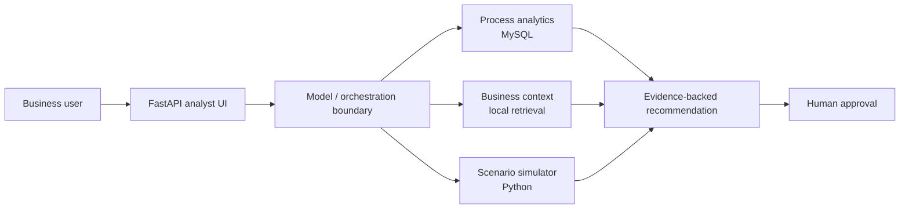

# Order-to-Cash Analytics + AI Process Improvement Agent

A portfolio project combining a realistic Order-to-Cash analytics database with a bounded AI-assisted process-improvement and scenario-planning system.

  

## 📋 Project Overview

This project provides a complete Order-to-Cash (O2C) database system that tracks the entire customer transaction lifecycle from order placement through cash collection. It includes realistic sample data and pre-built analytical views for business intelligence.

## 🤖 AI Process Improvement & Scenario Planning Agent

### Project at a glance

| Area | Implementation |
|---|---|
| Business problem | Diagnose O2C deterioration and evaluate improvement options |
| User experience | FastAPI analyst UI + natural-language business questions |
| Data | MySQL O2C transactional/analytical model |
| Agent tools | Stage comparison, KPI drill-down, context retrieval, baseline lookup, scenario simulation |
| Guardrails | Read-only analytics, no free-form SQL, causal-discipline rules, human approval |
| State | Session lineage + bounded analyst preferences |
| Evaluation | Controlled Scenario V1, 7 deterministic behavior cases, semantic rubric, CI smoke tests |
| Demo mode | Free scripted mock by default; optional OpenAI Responses API backend |
| Deployment | Docker Compose |


This branch extends the SQL project into a deployable business-analysis agent with:

- FastAPI analyst UI and API;
- bounded process-analytics tools over MySQL;
- local business-context retrieval;
- deterministic Python what-if simulation;
- short-term session state and bounded analyst preferences;
- trace/evaluation infrastructure;
- a **free scripted mock backend** for portfolio demos;
- an optional OpenAI Responses API backend for later real-model validation.

### Zero-cost portfolio demo

Requirements: Docker Desktop / Docker Compose v2.

Fast path on macOS/Linux:

```bash
make demo-open
```

Equivalent direct command:

```bash
git checkout feature/process-improvement-agent
bash agent/scripts/start_demo.sh --open
```

Then open:

```text
http://localhost:8000/
```

Click **Full diagnosis** → **Run investigation**.

The demo runs a real four-tool workflow against the synthetic O2C database:

```text
stage comparison
    ↓
channel drill-down
    ↓
process-context retrieval
    ↓
scenario simulation
    ↓
business recommendation
```

The mock backend scripts the investigation path so the demo costs $0, but the MySQL queries, KPI values, policy retrieval, scenario calculations, FastAPI service, UI, tool trace, and deterministic evaluation are the real project components.

### Agent architecture



The free demo uses a scripted mock only at the model/orchestration boundary. The same business tools remain available to the optional OpenAI Responses API backend.

See [Agent README](agent/README.md), [Documentation Index](agent/docs/README.md), [Demo Quick Start](agent/docs/demo_quickstart.md), [Prompt & Tool Design](agent/docs/prompt_design.md), [Business Requirements](agent/docs/business_requirements.md), [Process Improvement Case](agent/docs/process_improvement_case.md), and [Demo Interview Q&A](agent/docs/demo_interview_qa.md).

### Validated demo evidence

- controlled Scenario V1 benchmark;
- **7/7** scripted mock integration cases passed deterministic trace checks;
- one-command portfolio demo smoke test passes end-to-end;
- Docker/API/UI smoke tests pass;
- browser UI includes readiness checks, process-flow highlighting, evidence tables, tool path, stateful follow-up, presentation mode, and Markdown report export.

See [Portfolio MVP Report](agent/docs/portfolio_final_report.md), [Mock Evaluation Report](agent/docs/mock_evaluation_report.md), [Sample Demo Output](agent/docs/sample_demo_output.md), and [Demo One-Pager](agent/docs/demo_one_pager.md).

### Business Process Coverage
- **Customer Management**: Customer segmentation, credit limits, payment terms
- **Product Catalog**: Multi-category inventory with pricing and cost tracking
- **Order Management**: Multi-channel order processing with promotional codes
- **Inventory Control**: Real-time stock tracking across multiple locations
- **Fulfillment**: Shipment tracking with carrier and delivery performance
- **Billing**: Automated invoice generation with tax and freight calculations
- **Collections**: Payment processing with multiple payment methods
- **Returns**: Return merchandise authorization and disposition tracking

## 🗄️ Database Schema

### Core Tables (9 tables)
- `customers` - Customer master data with segmentation
- `products` - Product catalog with pricing and inventory parameters
- `orders` - Order header information with status tracking
- `order_items` - Order line items with pricing and discounts
- `inventory` - Real-time inventory levels by location
- `shipments` - Shipment tracking and delivery performance
- `invoices` - Billing information with tax and freight
- `payments` - Payment collection and cash application
- `returns` - Return processing and refund tracking

### Key Relationships
```
Customers → Orders → Order Items → Products
    ↓         ↓         ↓
  Orders → Shipments → Invoices → Payments
    ↓
  Returns
```

## 🚀 Quick Start

### Option 1: Complete Setup (Recommended)
```bash
# Clone the repository
git clone <your-repo-url>
cd o2c-analytics-project

# Run complete setup (creates everything)
mysql -u username -p < sql/complete_setup.sql
```

### Option 2: Step-by-Step Setup
```bash
# 1. Create database and tables
mysql -u username -p < sql/01-setup/create_database.sql
mysql -u username -p < sql/01-setup/create_tables.sql

# 2. Load sample data
mysql -u username -p o2c < sql/02-data/sample_data.sql

# 3. Create business views
mysql -u username -p o2c < sql/03-views/business_views.sql
```

### Option 3: Large Dataset Generation
```bash
# Generate 500+ orders with realistic data
mysql -u username -p o2c < sql/02-data/generate_large_dataset.sql
```

## 📊 Sample Data Overview

- **60 Customers** across 3 segments (SMB/Mid/Enterprise) and 4 regions
- **25 Products** across Electronics, Apparel, and Home categories  
- **500+ Orders** spanning 6 months with realistic seasonal patterns
- **1000+ Order Items** with varied quantities and pricing
- **Complete Transaction Flow** including shipments, invoices, and payments
- **Realistic Business Scenarios** (partial payments, returns, multichannel orders)

## 🔍 Key Business Views

### Customer Analytics
```sql
SELECT * FROM vw_customer_analytics 
ORDER BY total_revenue DESC;
```

### Product Performance
```sql
SELECT * FROM vw_product_performance 
WHERE gross_margin_pct > 40;
```

### Cash Flow Analysis
```sql
SELECT * FROM vw_cash_flow_analysis 
WHERE payment_status = 'UNPAID';
```

### Operational Performance
```sql
SELECT * FROM vw_operational_performance 
WHERE total_o2c_cycle_days > 45;
```

## 📈 Sample Analytics Queries

### Monthly Revenue Trends
```sql
SELECT 
    DATE_FORMAT(order_ts, '%Y-%m') as month,
    COUNT(*) as total_orders,
    SUM(net_amount) as revenue,
    AVG(net_amount) as avg_order_value
FROM vw_order_summary 
GROUP BY DATE_FORMAT(order_ts, '%Y-%m')
ORDER BY month;
```

### Customer Segment Performance  
```sql
SELECT 
    customer_segment,
    COUNT(*) as customers,
    SUM(total_revenue) as segment_revenue,
    AVG(total_revenue) as avg_customer_value
FROM vw_customer_analytics 
GROUP BY customer_segment;
```

### Top Performing Products
```sql
SELECT 
    category,
    sku,
    net_revenue,
    gross_margin_pct,
    turnover_ratio
FROM vw_product_performance 
ORDER BY net_revenue DESC
LIMIT 10;
```

## 🛠️ Project Structure

```
o2c-analytics-project/
├── sql/
│   ├── 01-setup/          # Database and table creation
│   ├── 02-data/           # Data loading and generation
│   ├── 03-views/          # Business intelligence views
│   ├── 04-reports/        # Sample analytical queries
│   └── complete_setup.sql # One-click complete setup
├── docs/                  # Detailed documentation
├── tests/                 # Data validation queries
├── examples/              # Sample dashboard queries
└── scripts/               # Automation scripts
```

## 💼 Use Cases

### Business Intelligence
- Customer profitability analysis
- Product performance tracking
- Regional sales analysis
- Channel effectiveness measurement

### Operations Management
- Order-to-cash cycle optimization
- Inventory turnover analysis
- Delivery performance monitoring
- Payment collection efficiency (DSO)

### Financial Analysis
- Revenue recognition tracking
- Accounts receivable aging
- Cash flow forecasting
- Return rate analysis

## 🧪 Testing & Validation

Run data validation tests:
```sql
-- Check data integrity
source tests/data_validation.sql

-- Verify business logic
SELECT * FROM vw_order_summary WHERE net_amount < 0;
```

## 🔗 Advanced Features

### Custom Time Periods
All views support date filtering for custom analysis periods.

### Drill-Down Capability  
Views are designed for hierarchical analysis (segment → customer → order → item).

### Performance Optimized
Includes proper indexing for fast query performance on large datasets.

## 📚 Documentation

- [Database Schema Details](docs/database-schema.md)
- [Business Requirements](docs/business-requirements.md)
- [API Documentation](docs/api-documentation.md)

## 🤝 Contributing

1. Fork the repository
2. Create a feature branch
3. Add your enhancements (new views, reports, or optimizations)
4. Submit a pull request

## 📄 License

This project is open source and available under the [MIT License](LICENSE).

## 🎯 Next Steps

After setup, try these sample queries from the `examples/` folder:
- Customer segmentation analysis
- Product profitability dashboard
- Operational KPI monitoring
- Cash flow management reports

---

**Ready to explore your O2C data?** Start with the Quick Start guide above!
